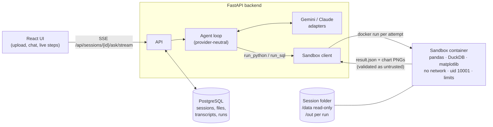

# DataSage

Upload a CSV or Excel file and ask questions about it in plain English. An agent writes pandas code or DuckDB SQL, runs it in a locked-down Docker sandbox, fixes its own errors, and answers with the result table, a chart, and the exact code it used.

- **Hand-written agent loop**, no agent framework. It runs on two LLM providers through small adapters: Google Gemini (default) and Anthropic Claude.
- **Untrusted code never runs in the backend.** Every run gets a throwaway container with no network, CPU, memory and process limits, a time limit, a non-root user, a read-only filesystem, and only its own session's files mounted.
- **Self-correction:** a failing run's traceback goes back to the model, which fixes the code and retries, up to a limit.
- **Live progress** in the UI over Server-Sent Events: each step, each code attempt, and each error.
- **Evals with known answers:** 34 questions over 4 generated datasets, scored automatically. Reports list regressions between runs.

## How it works



1. **Upload:** the file is stored under a random id in the session's folder and profiled: types, missing values, stats and sample rows.
2. **Ask:** the agent calls `get_profile`, then `run_python` or `run_sql`. In Auto mode it picks; the user can force Python or SQL.
3. **Each run** starts a fresh container that mounts the session's files read-only and one empty output folder. SQL runs in DuckDB with every file loaded as a table, with file access off and settings locked.
4. **Errors** (tracebacks, SQL errors, timeouts, out-of-memory) go back to the model as tool errors. It fixes them and runs again.
5. **The answer** shows the text, plus the table, chart and code of the last successful run. Everything is stored: the full model transcript and every code run.

## Eval results

Latest report: [docs/evals/](docs/evals/), on `gemini-3.5-flash-lite`.

| Dataset | What it tests | Run 1 | Run 2 |
|---|---|---|---|
| sales | prices stored as text, mixed `DD/MM/YYYY` and ISO dates | 11/12 | 12/12 |
| employees | a clean Excel file, a chart | 10/10 | 9/10 |
| weather | missing values, correlation, a line chart | 7/7 | 7/7 |
| shop | two CSVs to join, customers with no orders | 5/5 | 5/5 |
| **Total** | 4 cases force SQL, 4 ask for a chart | **33/34** | **33/34** |

Scoring is deterministic: expected numbers, rows and names must appear in the answer or its table (within tolerances), and charts must exist when asked for. The known weak spot is mixed date formats. Each run, about one case changes outcome.

```bash
uv run --project backend python -m evals.run            # all cases (real LLM + sandbox; costs money)
uv run --project backend python -m evals.run --only sales
```

## Run it

### With Docker Compose (Linux host)

```bash
cp .env.example .env        # set GEMINI_API_KEY (or LLM_PROVIDER=anthropic + ANTHROPIC_*)
docker compose up -d --build
open http://localhost:8000
```

Compose builds the sandbox image, starts Postgres, and starts the app. The app serves the API at `/api` and the built frontend at `/`. It runs sandboxes through the host's Docker socket. Only the app container gets that socket, never a sandbox, and holding it is root-equivalent on the host.

### Local development (Windows + WSL, as this repo is developed)

Postgres 16 and Docker Engine run inside a WSL distro on `E:`; the backend and frontend run on Windows. See [CLAUDE.md](CLAUDE.md) for the rules and [docs/decisions.md](docs/decisions.md) for why.

```powershell
.\scripts\sandbox.ps1 build   # start Docker in WSL, build datasage-sandbox:latest
.\scripts\dev.ps1             # Postgres + Docker + backend (:8000) + frontend (:5173)
```

## Tests

```bash
cd backend && uv run pytest        # 120+ tests; the LLM is always mocked; sandbox tests use real Docker
cd frontend && npm test            # Vitest
```

CI ([.github/workflows/ci.yml](.github/workflows/ci.yml)) runs ruff, every backend test (including real-container sandbox tests), the frontend checks, and a Compose smoke test. The smoke test builds the production image, uploads a file, and starts a sandbox from inside the app container.

## Configuration

Every setting is in [.env.example](.env.example). The main ones:

| Variable | Meaning |
|---|---|
| `LLM_PROVIDER` | `gemini` (default) or `anthropic` |
| `GEMINI_API_KEY`, `GEMINI_MODEL` | Gemini credentials and model id |
| `ANTHROPIC_API_KEY`, `ANTHROPIC_MODEL`, `ANTHROPIC_EFFORT` | Claude credentials, model id and effort |
| `SANDBOX_TIMEOUT_SECONDS`, `SANDBOX_MEMORY_MB`, `SANDBOX_CPUS`, `SANDBOX_PIDS` | Per-run sandbox limits |
| `AGENT_MAX_ITERATIONS`, `AGENT_MAX_CODE_ERRORS` | Model calls per question; failed runs before giving up |
| `MAX_UPLOAD_MB`, `ASK_LIMIT_PER_HOUR`, `SESSION_TTL_DAYS` | Upload size, questions per IP per hour, data retention |

## Project layout

```
backend/app/
  agents/     loop.py (tool-use loop, prompt, tools), providers.py (Gemini + Anthropic adapters)
  sandbox/    client.py (docker run with every limit; validates all output as untrusted)
  services/   uploads + profiling, questions (runs the agent, stores everything)
  api/        sessions, uploads, ask (JSON + SSE), history, charts
  core/       settings, limits (body size, questions per IP, cleanup)
sandbox-image/  Dockerfile + run.py (Python and DuckDB runner inside the container)
frontend/src/   React UI
evals/          datasets, cases with known answers, runner, scorer
docs/           decisions.md, eval reports
```

## Limits and known gaps

- **Disk use:** each file a sandbox writes is capped, but not the number of files, so `/out` can grow until the time limit. A size-limited volume is needed before a public deploy.
- **Isolation:** sandboxes rely on Docker's isolation (namespaces, seccomp, no capabilities). gVisor would be stronger on a host that supports it.
- **Rate limit:** the question limit is in-process memory, so it resets on restart.
- **One backend process:** startup cleanup assumes a single backend process per Docker host and database.
- **Excel and CSV:** only the first sheet of an Excel file is read, and CSVs must be comma-separated.
